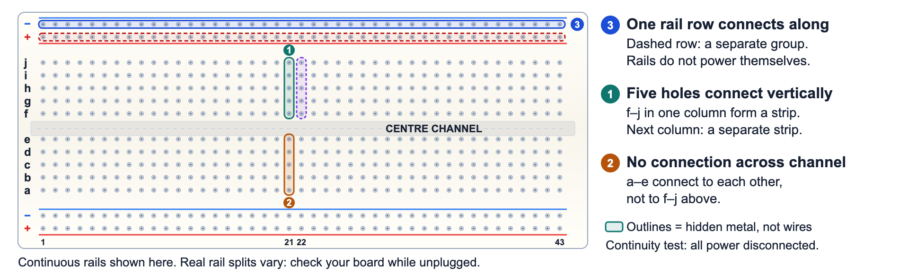
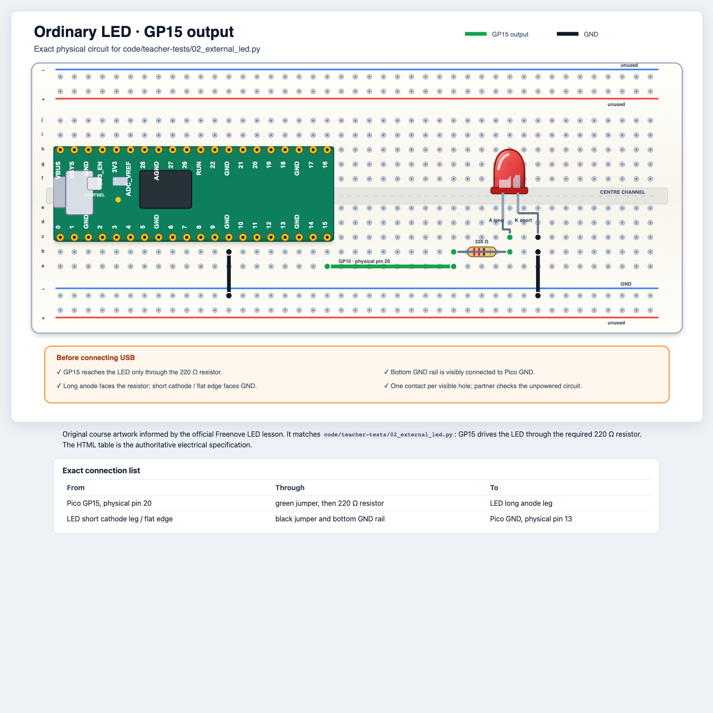

# Tag 1: Bringt Licht ins Spiel

## Mission

Am Ende des Tages sendet euer Code eine geheime Nachricht mit Licht.

**Python:** Interpreter, Skript, `print`, Strings, Integer, Floats, Variablen,
Zuweisung, Kommentare, Importe, Fehler, `try`/`finally`<br>
**Hardware:** eingebaute LED, externe LED, GPIO-Ausgang<br>
## 1. Lernt den Interpreter kennen

Beginnt ohne Pico. Öffnet Thonny und wählt unten rechts **Lokales Python 3**
(Thonnys eingebautes Python), nicht MicroPython. Bei englischer Oberfläche
heißt es **Local Python 3**. Diese ersten Beispiele laufen auf eurem Computer.
Fehlt die Dateiansicht, wählt **Ansicht → Dateien**.

Gebt in Thonnys Shell jeweils eine Zeile ein:

```python
print("Hello, Pico!")
2 + 3
```

Besprecht:

- Ein String ist Text in Anführungszeichen.
- Ein Integer ist eine ganze Zahl.
- Ein Float enthält eine Dezimalstelle.
- Ein Ausdruck erzeugt einen Wert.
- Ein Interpreter führt Code aus.

Nachdem ihr diese Typen besprochen habt, fragt ihr Python mit `type(...)`,
welchen Typ ein Wert hat:

```python
type("hello")
type(42)
type(0.5)
```

Erzeugt absichtlich drei Fehler. Lest jeweils die letzte Zeile der
Fehlermeldung:

```python
print("missing quote)
pritn("misspelled name")
10 / 0
```

Fehler liefern Informationen. Sie bedeuten nicht, dass ihr gescheitert seid.

### Ein Skript auf dem Computer ausführen

1. Klickt auf <a href="../../code/day-1/00_first_script.py" download="00_first_script.py"><code>00_first_script.py</code></a>,
   um die Datei nach **Downloads** herunterzuladen. Fragt der Browser nach
   dem Speicherort, wählt **Downloads** und behaltet den Dateinamen mit `.py` bei.
2. Öffnet in Thonny **links unter Dateien** den Ordner **Downloads** auf eurem
   Computer. Fehlt die Dateiansicht, wählt **Ansicht → Dateien**; bei englischer
   Oberfläche **View → Files**. Öffnet **`00_first_script.py`** mit einem
   Doppelklick im Editor.
3. Lasst **Lokales Python 3** ausgewählt. Sagt die Ausgabe voraus und klickt
   dann auf den **grünen Play-Button (Run)**. Die Ausgabe erscheint in der Shell.

Im Editor seht ihr jetzt ein **Skript**: Anweisungen, die in einer `.py`-Datei
gespeichert sind. Python führt sie von oben nach unten aus. Klickt erneut auf
den grünen Play-Button, um die ganze Abfolge zu wiederholen:

```python
print("Three...")
print("Two...")
print("One...")
print("Hello, physical world!")
```

Ersetzt nun den Inhalt derselben Datei durch das folgende Beispiel, um Pausen
einzubauen. Sagt die Reihenfolge der Meldungen und die Pausen voraus, wählt
**Datei → Speichern** und klickt dann auf den **grünen Play-Button (Run)**:

```python
from time import sleep

print("Three...")
sleep(1)
print("Two...")
sleep(1)
print("One...")
```

Mit `import` nutzen wir fertige Werkzeuge. Python bündelt diese in **Modulen**.
`from time import sleep` stellt die Pausenfunktion `sleep` aus dem Modul `time`
bereit, Pythons Werkzeugkasten für Zeitaufgaben. Der Import pausiert das
Programm noch nicht; `sleep(1)` wartet eine Sekunde. Ihr braucht weder Pico
noch Verkabelung.

## 2. Euer erstes Programm mit sichtbarer Wirkung

Wartet, bis eure Lehrkraft die Picos austeilt und die Platine vorstellt. Der
Pico ist eine Mikrocontroller-Platine, die Python mit **MicroPython** ausführt
und Sensoren auslesen sowie elektronische Bauteile steuern kann.

Verbindet den Pico per USB und wechselt dann in Thonny von **Lokalem Python 3**
zu **MicroPython (Raspberry Pi Pico)**. Lasst den Port **automatisch erkennen**.
Prüft, ob `>>>` in der Shell erscheint; Code läuft jetzt auf dem Pico, nicht
mehr auf eurem Computer. Die eingebaute LED braucht keine externe Verkabelung.

1. Klickt auf <a href="../../code/day-1/01_hello_pico.py" download="01_hello_pico.py"><code>01_hello_pico.py</code></a>,
   um die Datei nach **Downloads** herunterzuladen. Fragt der Browser nach
   dem Speicherort, wählt **Downloads**.
2. Öffnet in Thonny **links unter Dateien** den Ordner **Downloads auf eurem
   Computer** und klickt **`01_hello_pico.py`** doppelt an. Lasst die Datei auf
   dem Computer, nicht auf dem Pico. Prüft den Namen im Editor-Tab: Dies ist
   eine andere Datei als `00_first_script.py`.
3. Prüft vor dem Ausführen, ob **MicroPython (Raspberry Pi Pico)** ausgewählt
   ist. Der vorgegebene `try`-Block führt die Abfolge aus; `finally` schaltet
   die LED am Ende, bei einem Fehler oder bei Stop aus. Lasst beide Blöcke stehen.
4. Sagt die Reihenfolge der Meldungen und LED-Wechsel voraus und klickt dann
   auf den **grünen Play-Button (Run)**. Beobachtet Shell und eingebaute LED gemeinsam.

```python
from machine import Pin
from time import sleep

led = Pin("LED", Pin.OUT)

try:
    print("Three...")
    led.on()
    sleep(1)

    print("Two...")
    led.off()
    sleep(1)

    print("One...")
    led.on()
    print("Hello, physical world!")
    sleep(1)
finally:
    led.off()
```

Führt es erneut aus und vergleicht Vorhersage und Beobachtung. Ändert dann die
Wörter und die Wartezeit, speichert und klickt wieder auf den grünen Play-Button.

`Pin("LED", Pin.OUT)` erzeugt ein Ausgangsobjekt. Der Aufruf `led.on()` ändert
eine Spannung und damit die reale Welt.

## 3. Variablen sind beschriftete Speicherplätze

Führt [`code/day-1/02_variable_blink.py`](../../code/day-1/02_variable_blink.py)
aus.

Ändert nur diese Werte:

```python
message = "Team Comet"
on_time = 0.15
off_time = 0.35
```

Welche Änderung beeinflusst den Text und welche beeinflussen das Timing? Warum
sind die Zeitwerte Floats und keine Strings?

Die Datei wiederholt absichtlich drei ähnliche Codeblöcke. Ihr müsst sie noch
nicht kürzen. An Tag 3 lernt ihr Schleifen und Funktionen kennen, mit denen ihr
solche Wiederholungen vermeidet.

## 4. Baut eine externe LED

### So verbindet das Breadboard die Kontakte

Seht euch das [markierte Vorlagen-Breadboard mit Verbindungstabelle](../../diagrams/breadboard-connectivity.html) an:



**1:** Die fünf Löcher f–j einer Spalte sind verbunden; die Nachbarspalte ist getrennt.
**2:** a–e bilden eine eigene Gruppe, ohne Verbindung über die Mittelrinne.
**3:** Löcher entlang einer Schienenreihe sind verbunden, getrennt von anderen Reihen.
Die Markierungen zeigen verborgene Metallstreifen, keine zusätzlich benötigten Kabel.
Die Buchstaben laufen von a unten bis j oben. In jedem Schienenpaar liegt Blau
(−) über Rot (+), passend zum Workshop-Breadboard.

Untersucht das Breadboard bei getrennter USB-Verbindung:

- Jeder Fünferstreifen im Steckfeld ist intern verbunden.
- Die mittlere Rinne trennt beide Steckfelder; gegenüberliegende Löcher
  sind **nicht** miteinander verbunden.
- Die langen äußeren Versorgungsschienen sind von den Steckfeldern und
  voneinander getrennt. Manche sind in der Mitte unterbrochen: Prüft den
  Durchgang bei getrennter Stromversorgung.
- Eine rote Linie ist nur eine Markierung, keine Spannungsquelle. Erst der
  Anschluss an die passende Pico-Versorgung macht daraus 3.3 V oder 5 V.
  Verbindet diese Spannungen niemals miteinander.
- Steckt nur ein Bein oder Kabelende in jedes Loch. Nutzt separate Löcher
  desselben verbundenen Streifens, um Bauteile miteinander zu verbinden.

Trennt zuerst die USB-Verbindung.

Öffnet das
[skalierbare, barrierearme Diagramm für die gewöhnliche LED](../../diagrams/ordinary-led.html)
und baut die Schaltung genau nach der Verbindungstabelle auf.



Stellt die USB-Verbindung erst wieder her, nachdem beide aus dem Team Folgendes
geprüft haben:

- GP15 führt über einen 220-Ω-Widerstand zur LED;
- das lange und das kurze Bein der LED sind richtig ausgerichtet;
- GND und GP15 sind nicht direkt verbunden.

Erstellt eine Kopie von `code/day-1/02_variable_blink.py`. Ersetzt in der Kopie
`Pin("LED", Pin.OUT)` durch `Pin(15, Pin.OUT)`. Führt dann zuerst den kleinsten
Test für die externe LED aus, bevor ihr das Muster ändert.

### Sicher stoppen mit `try`/`finally`

Lernt dieses Aufräummuster vor dem ersten Programm, das es verwendet:

```python
try:
    led.on()
    sleep(1)
finally:
    led.off()
```

Der eingerückte `try`-Block führt die Aufgabe aus. `finally` läuft, wenn
dieser Block verlassen wird: nach dem Ende, bei einem Fehler oder bei einer
Unterbrechung mit `Ctrl+C`. Die LED bleibt danach aus. Fehler werden nicht
versteckt; Thonny kann weiterhin `KeyboardInterrupt` anzeigen. Spätere
Programme verwenden das Muster für PWM und RGB-Pixel. Durch Trennen der
Stromversorgung wird kein Aufräumcode ausgeführt.

## 5. Fehlersuche als Staffel

Eure Lehrkraft gibt jedem Team einen Fehler:

- fehlende schließende Klammer;
- falscher Großbuchstabe;
- falsche Pin-Nummer;
- LED verkehrt herum;
- ein Kabel um eine Reihe versetzt;
- Code aus einem früheren Test läuft noch.

Beschreibt das Symptom, führt genau einen Test durch und notiert den Hinweis,
den das Ergebnis liefert. Ändert nicht wahllos gleichzeitig Code und
Verkabelung.

## Tagesprojekt: Geheime Signalmaschine

Erfindet ein Signal mit:

- einem ausgegebenen Teamnamen;
- mindestens zwei benannten Zeitvariablen;
- kurzen und langen Lichtsignalen;
- einer deutlichen Pause zwischen den Signalgruppen;
- Kommentaren, die die Nachricht erklären;
- einem sauberen abschließenden `off`-Zustand.

Beginnt mit
[`code/day-1/03_secret_signal_1_starter.py`](../../code/day-1/03_secret_signal_1_starter.py).
Öffnet die Lösung erst, wenn eure eigene Nachricht funktioniert.

Mögliche Themen: Weltraumbake, Robotergruß, Leuchtturm, Torjubel oder
Morsecode-Initialen.

### Checkliste für die Vorführung

- Erkennt ein anderes Team, wo eine Signalgruppe endet und die nächste beginnt?
- Könnt ihr die Geschwindigkeit ändern, indem ihr nur Variablen bearbeitet?
- Könnt ihr den Unterschied zwischen Programm und Ausgabe erklären?

## Abschlussticket

Vervollständigt den Satz: „Wenn Python `led.on()` ausführt, ist die Ausgabe
___, und wenn Python `print()` ausführt, ist die Ausgabe ___.“
