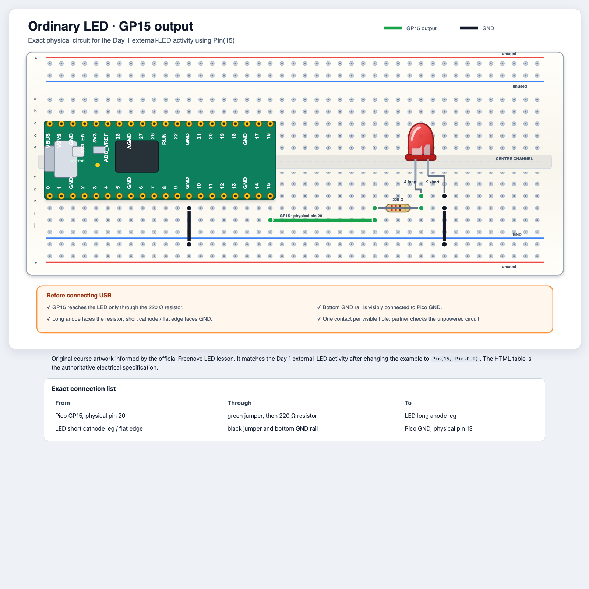

# Tag 1: Bringt Licht ins Spiel

## Mission

Am Ende des Tages sendet euer Code eine geheime Nachricht mit Licht.

**Python:** Interpreter, Skript, `print`, Strings, Integer, Floats, Variablen,
Zuweisung, Tupel, `None`, Kommentare, Importe, Fehler, `try`/`finally`<br>
**Hardware:** eingebaute LED, externe LED, GPIO-Ausgang<br>
## 1. Lernt den Interpreter kennen

Gebt in Thonnys Shell jeweils eine Zeile ein:

```python
print("Hello, Pico!")
2 + 3
type("hello")
type(42)
type(0.5)
type((0, 0, 20))
type(None)
```

Besprecht:

- Ein String ist Text in Anführungszeichen.
- Ein Integer ist eine ganze Zahl.
- Ein Float enthält eine Dezimalstelle.
- Ein Tupel ist eine geordnete Gruppe von Werten mit Kommas und meist
  Klammern: `(0, 0, 20)`. Seine Elemente lassen sich nicht ersetzen. An Tag 3
  stehen diese drei Werte für die Helligkeit von Rot, Grün und Blau.
- `None` ist ein besonderer Wert für „kein Wert“ oder „kein Ergebnis“.
  Er ist nicht `0`, `False` oder ein leerer String und hat den Typ `NoneType`.
- Ein Ausdruck erzeugt einen Wert.
- Ein Interpreter führt Code aus.

Erzeugt absichtlich drei Fehler. Lest jeweils die letzte Zeile der
Fehlermeldung:

```python
print("missing quote)
pritn("misspelled name")
10 / 0
```

Fehler liefern Informationen. Sie bedeuten nicht, dass ihr gescheitert seid.

## 2. Euer erstes Programm mit sichtbarer Wirkung

Öffnet [`code/day-1/01_hello_pico.py`](../../code/day-1/01_hello_pico.py).

Sagt vor dem Ausführen voraus, in welcher Reihenfolge die Meldungen erscheinen
und die LED ihren Zustand ändert. Ändert danach die Wörter und die Wartezeit.

```python
from machine import Pin
from time import sleep

led = Pin("LED", Pin.OUT)

print("Three...")
led.on()
sleep(1)
print("Two...")
led.off()
sleep(1)
print("One...")
led.on()
print("Hello, physical world!")
```

`Pin("LED", Pin.OUT)` erzeugt ein Ausgangsobjekt. Der Aufruf `led.on()` ändert
eine Spannung und damit die reale Welt.

## 3. Variablen sind beschriftete Speicherplätze

Führt [`code/day-1/02_variable_blink.py`](../../code/day-1/02_variable_blink.py)
aus.

Ändert nur diese Werte:

```python
message = "Team Comet"
on_time = 0.15
off_time = 0.35
```

Welche Änderung beeinflusst den Text und welche beeinflussen das Timing? Warum
sind die Zeitwerte Floats und keine Strings?

Die Datei wiederholt absichtlich drei ähnliche Codeblöcke. Ihr müsst sie noch
nicht kürzen. An Tag 3 lernt ihr Schleifen und Funktionen kennen, mit denen ihr
solche Wiederholungen vermeidet.

## 4. Baut eine externe LED

### So verbindet das Breadboard die Kontakte

Untersucht das Breadboard bei getrennter USB-Verbindung:

- Jeder Fünferstreifen im Steckfeld ist intern verbunden.
- Die mittlere Rinne trennt beide Steckfelder; gegenüberliegende Löcher
  sind **nicht** miteinander verbunden.
- Die langen äußeren Versorgungsschienen sind von den Steckfeldern und
  voneinander getrennt. Manche sind in der Mitte unterbrochen: Prüft den
  Durchgang bei getrennter Stromversorgung.
- Eine rote Linie ist nur eine Markierung, keine Spannungsquelle. Erst der
  Anschluss an die passende Pico-Versorgung macht daraus 3.3 V oder 5 V.
  Verbindet diese Spannungen niemals miteinander.
- Steckt nur ein Bein oder Kabelende in jedes Loch. Nutzt separate Löcher
  desselben verbundenen Streifens, um Bauteile miteinander zu verbinden.

Trennt zuerst die USB-Verbindung.

Öffnet das
[skalierbare, barrierearme Diagramm für die gewöhnliche LED](../../diagrams/ordinary-led.html)
und baut die Schaltung genau nach der Verbindungstabelle auf.



Stellt die USB-Verbindung erst wieder her, nachdem beide aus dem Team Folgendes
geprüft haben:

- GP15 führt über einen 220-Ω-Widerstand zur LED;
- das lange und das kurze Bein der LED sind richtig ausgerichtet;
- GND und GP15 sind nicht direkt verbunden.

Erstellt eine Kopie von `code/day-1/02_variable_blink.py`. Ersetzt in der Kopie
`Pin("LED", Pin.OUT)` durch `Pin(15, Pin.OUT)`. Führt dann zuerst den kleinsten
Test für die externe LED aus, bevor ihr das Muster ändert.

### Sicher stoppen mit `try`/`finally`

Lernt dieses Aufräummuster vor dem ersten Programm, das es verwendet:

```python
try:
    led.on()
    sleep(1)
finally:
    led.off()
```

Der eingerückte `try`-Block führt die Aufgabe aus. `finally` läuft, wenn
dieser Block verlassen wird: nach dem Ende, bei einem Fehler oder bei einer
Unterbrechung mit `Ctrl+C`. Die LED bleibt danach aus. Fehler werden nicht
versteckt; Thonny kann weiterhin `KeyboardInterrupt` anzeigen. Spätere
Programme verwenden das Muster für PWM und RGB-Pixel. Durch Trennen der
Stromversorgung wird kein Aufräumcode ausgeführt.

## 5. Fehlersuche als Staffel

Eure Lehrkraft gibt jedem Team einen Fehler:

- fehlende schließende Klammer;
- falscher Großbuchstabe;
- falsche Pin-Nummer;
- LED verkehrt herum;
- ein Kabel um eine Reihe versetzt;
- Code aus einem früheren Test läuft noch.

Beschreibt das Symptom, führt genau einen Test durch und notiert den Hinweis,
den das Ergebnis liefert. Ändert nicht wahllos gleichzeitig Code und
Verkabelung.

## Tagesprojekt: Geheime Signalmaschine

Erfindet ein Signal mit:

- einem ausgegebenen Teamnamen;
- mindestens zwei benannten Zeitvariablen;
- kurzen und langen Lichtsignalen;
- einer deutlichen Pause zwischen den Signalgruppen;
- Kommentaren, die die Nachricht erklären;
- einem sauberen abschließenden `off`-Zustand.

Beginnt mit
[`code/day-1/03_secret_signal_1_starter.py`](../../code/day-1/03_secret_signal_1_starter.py).
Öffnet die Lösung erst, wenn eure eigene Nachricht funktioniert.

Mögliche Themen: Weltraumbake, Robotergruß, Leuchtturm, Torjubel oder
Morsecode-Initialen.

### Checkliste für die Vorführung

- Erkennt ein anderes Team, wo eine Signalgruppe endet und die nächste beginnt?
- Könnt ihr die Geschwindigkeit ändern, indem ihr nur Variablen bearbeitet?
- Könnt ihr den Unterschied zwischen Programm und Ausgabe erklären?

## Abschlussticket

Vervollständigt den Satz: „Wenn Python `led.on()` ausführt, ist die Ausgabe
___, und wenn Python `print()` ausführt, ist die Ausgabe ___.“
