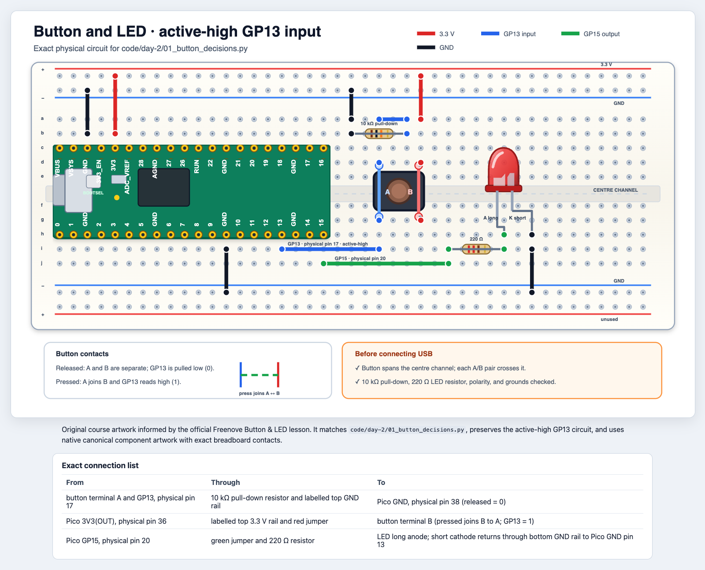
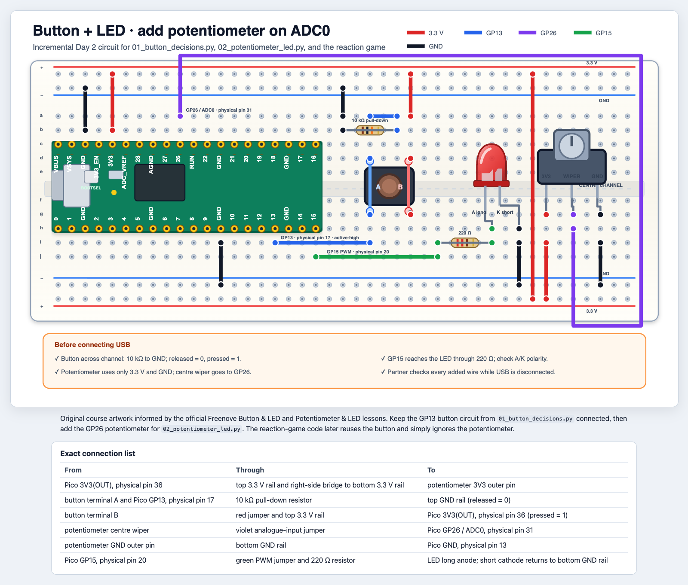

# Tag 2: Lasst es entscheiden

## Mission

Verwandelt physische Eingaben in Entscheidungen und baut anschließend eine
Reaktionszeit-Challenge.

**Python:** Boolean-Werte, Vergleiche, Casting, `if`/`elif`/`else`, `while`,
Listen, Indizes, `append`, `len`<br>
**Hardware:** Taster, ADC, Potentiometer, PWM-LED<br>
## 1. Ein Taster stellt eine Boolean-Frage

Trennt die USB-Verbindung. Holt den Taster, einen 10-kΩ-Widerstand, einen
220-Ω-Widerstand, eine rote LED und Jumperkabel.

[Öffnet das skalierbare HTML-Schaltbild des Kurses](../../diagrams/button-and-led.html).
Es zeigt die Pico-Anschlüsse, die Ausrichtung des Breadboards, die internen
Kontakte des Tasters und die Kontrollen vor dem Einschalten.



Baut in dieser Reihenfolge:

1. Richtet den Pico wie gezeigt mit dem USB-Anschluss nach links aus.
2. Setzt den Taster genau wie gezeigt über die mittlere Rinne.
3. Fügt den 10-kΩ-Pull-down-Widerstand und den 220-Ω-LED-Widerstand hinzu.
4. Verbindet Stromversorgung, GND, GP13 und GP15.
5. Eine Person liest die HTML-Verbindungstabelle laut vor, während die andere
   auf jedes Loch zeigt.

Ein Taster mit vier Beinen besitzt nur zwei elektrische Anschlüsse. Die beiden
blauen, im Diagramm mit A markierten Beine sind immer verbunden. Dasselbe gilt
für die beiden roten, mit B markierten Beine. Beim Drücken werden A und B
verbunden.

Prüft vor dem Anschließen von USB nach Möglichkeit mit einem Multimeter im
Durchgangsprüfmodus:

1. Zwei Beine desselben Anschlusses sollten auch bei losgelassenem Taster
   piepen.
2. Ein A-Bein und ein B-Bein sollten bei losgelassenem Taster nicht piepen.
3. Der A-zu-B-Test sollte nur bei gedrücktem Taster piepen.

Wenn ihr den Taster in denselben Löchern um 90 Grad dreht, kann die Eingabe
dauerhaft gedrückt wirken. Falls das Programm immer `Pressed: 1` ausgibt,
trennt USB und prüft die Ausrichtung, bevor ihr den Code ändert.

Führt
[`code/day-2/01_button_decisions.py`](../../code/day-2/01_button_decisions.py)
aus. Die Kursschaltung ist active-high:

```python
pressed = button.value()

if pressed:
    led.on()
else:
    led.off()
```

`if` wählt einen Pfad, wenn seine Boolean-Bedingung `True` ist; `else` wählt
den anderen Pfad. Das vorgegebene `while True` fragt den Taster immer wieder
ab, bis ihr Stop oder `Ctrl+C` drückt.

Der 10-kΩ-Pull-down-Widerstand verbindet GP13 mit GND. Bei losgelassenem
Taster liest GP13 `0`. Drücken verbindet GP13 mit 3.3 V und ergibt `1`.
Python behandelt `0` in einer Bedingung als falsch und `1` als wahr:
`if pressed:` bedeutet direkt „wenn der Taster gedrückt ist“. Der Eingang
erkennt Spannung, nicht Strom.

`not` kehrt einen Wahrheitswert um: `not True` ist `False`, `not False` ist
`True`. `not pressed` bedeutet also „der Taster ist nicht gedrückt“.
`and` verlangt zwei wahre Bedingungen, `or` mindestens eine. Setzt für die
folgenden Beispiele zuerst `score = 1` und `time_is_up = False`.

Sagt diese Ausdrücke voraus, bevor ihr sie ausprobiert:

```python
pressed == True
not pressed
pressed and score > 0
pressed or time_is_up
```

## 2. Von der analogen Welt zu Zahlen

Ein digitaler Eingang hat zwei Zustände. Ein Potentiometer kann viele Werte
liefern. Trennt USB, **lasst die Taster-und-LED-Schaltung unverändert** und
ergänzt nur die drei unten gezeigten Potentiometer-Verbindungen.

Öffnet das
[skalierbare, barrierearme Diagramm für Potentiometer und LED](../../diagrams/potentiometer-and-led.html),
um die genauen Breadboard-Kontakte und die Verbindungstabelle zu sehen.



Das nächste Programm verwendet GP13 nicht. Der angeschlossene Taster
beeinflusst den Potentiometer-Test daher nicht.

Führt
[`code/day-2/02_potentiometer_led.py`](../../code/day-2/02_potentiometer_led.py)
aus.

Der Pico liest eine Zahl von 0 bis 65535:

```python
raw_value = knob.read_u16()
percent = int(raw_value / 65535 * 100)
```

### ADC und PWM zum Nachschlagen

**ADC = Analog-to-Digital Converter (Analog-Digital-Wandler).** Er macht aus
einer Eingangsspannung eine Zahl. Das Potentiometer verändert die Spannung
an GP26; `knob.read_u16()` stellt ungefähr 0–3.3 V als Zahl von `0` bis
`65535` dar.

**PWM = Pulse-Width Modulation (Pulsweitenmodulation).** Sie schaltet einen
Ausgang schnell aus und ein. Der **Tastgrad (duty cycle)** ist der Anteil der
Zeit, in dem er eingeschaltet bleibt: 10% ergibt eine schwach leuchtende LED,
90% eine helle. `led.duty_u16(...)` legt diesen Anteil mit `0` bis `65535`
fest. Der Pin wechselt zwischen ungefähr 0 V und 3.3 V; er liefert keine
gleichbleibende Zwischen-Spannung. **ADC liest den Drehknopf; PWM steuert die
Helligkeit.**

Mit `Pin(..., Pin.IN).value()` an GP26 würdet ihr nur `0` oder `1` lesen,
nicht die Drehknopfposition. Der Umschaltpunkt liegt nicht garantiert in
der Mitte. Für eine ausdrückliche Prüfung der oberen Hälfte verwendet
`knob.read_u16() >= 32768`.

Hier wandelt `int(...)` durch Casting einen Float in einen Integer um. Notiert
Werte nahe 0 %, 25 %, 50 %, 75 % und 100 %. Echte Messwerte sind nicht exakt.

Die PWM-Helligkeit verwendet einen Wert von 0 bis 65535:

```python
led.duty_u16(0)      # off
led.duty_u16(20000)  # dim
led.duty_u16(65535)  # full brightness
```

Ein `elif` fügt einen weiteren möglichen Pfad hinzu. Python führt nur den
ersten Zweig aus, dessen Bedingung wahr ist:

```python
if points >= 10:
    print("gold")
elif points >= 5:
    print("silver")
else:
    print("bronze")
```

### Schwellenwert-Challenge

Ändert das Programm so, dass die LED:

- unter 20 % aus ist;
- von 20 % bis 70 % schwach leuchtet;
- über 70 % hell leuchtet.

Verwendet `if`, `elif` und `else`.

## 3. Listen merken sich mehrere Ergebnisse

Probiert dies in der Shell aus:

```python
times = [410, 375, 522]
print(times[0])
times.append(330)
print(len(times))
print(min(times))
```

Indizes beginnen bei null. Sagt voraus, was `times[-1]` zurückgibt.

## 4. Eine `while`-Schleife wiederholt, solange eine Bedingung wahr ist

Ein Spiel muss den Taster beim Warten ständig prüfen:

```python
while not button.value():
    sleep_ms(1)
```

Lest dies so: „Solange der Taster losgelassen ist, wartet 1 ms und prüft
erneut.“ Die Schleife endet, wenn `button.value()` zu `1` wird. Anders als
`while True` hat diese Schleife eine Bedingung, die falsch werden kann.

Das entgegengesetzte Warten prüft direkt, ob der Taster gedrückt ist:

```python
while button.value():
    sleep_ms(10)
```

Lest dies so: „Solange der Taster gedrückt ist, wartet, bis er losgelassen
wird.“ Testet beide Schleifen mit print-Ausgaben, bevor ihr sie in das Spiel
einbaut.

Sagt voraus, welche Schleife sich für welche Aufgabe eignet:

- das gesamte Spiel weiterlaufen lassen;
- warten, bis der Taster gedrückt wird;
- wiederholen, bis fünf Ergebnisse gespeichert sind.

Die Datei für das Reaktionsspiel verwendet außerdem vorgegebene Timing-Werkzeuge
wie `randint()` und `ticks_ms()`. Ihr dürft diese Werkzeuge aufrufen, ohne zu
wissen, wie sie aufgebaut sind.

### Bereitschaftscheck vor dem Spiel

Alles, was ihr für die Grundversion schreiben müsst, wurde jetzt geübt:

| Spielcode | Wo er eingeführt wurde |
|---|---|
| Variablen und Zuweisung | Tag 1 |
| active-high `button.value()`, `not` und `and` | Tag 2, Abschnitt 1 |
| `if`/`else` und Vergleiche | Tag 2, Abschnitte 1 und 2 |
| `scores = []`, `append`, `len` und `min` | Tag 2, Abschnitt 3 |
| `while` mit einer Bedingung | Tag 2, Abschnitt 4 |
| Aufruf vorgegebener Werkzeuge wie `sleep_ms()` | Beispiele seit Tag 1 |

Für die Grundversion braucht ihr **kein** `for`, `range`, `def`, keine
Dictionaries und keine endlose `while True`-Schleife. Diese Ideen lernt ihr
entweder später oder sie bleiben Teil des vorgegebenen Gerüsts. `randint()`,
`ticks_ms()` und `ticks_diff()` sind vorgegebene Timing-Werkzeuge; ihr
verwendet nur die unten aufgeführten Aufrufmuster.

## Tagesprojekt: Reaktionszeit-Challenge

Lasst die vollständige Schaltung verbunden. Das Reaktionsspiel nutzt den
Taster an GP13 und die LED an GP15; das Potentiometer an GP26 wird einfach
ignoriert. Beginnt mit
[`code/day-2/03_reaction_game_1_starter.py`](../../code/day-2/03_reaction_game_1_starter.py).
Der Starter enthält Importe, Pin-Einrichtung, eine leere `scores`-Liste und das
sichere Ausschalten der LED. **Ihr schreibt das Spiel.**

### So funktioniert das Spiel

Lasst den Taster los und wartet. Sobald die LED aufleuchtet, drückt ihr so
schnell wie möglich. Ein am Ende der zufälligen Wartezeit noch gedrückter Taster ist ein **Fehlstart**:
Dieser Versuch zählt nicht, und ihr versucht es erneut. Spielt drei gültige
Runden und vergleicht eure Reaktionszeiten. Die erste Version hat zwei
Ergebniskategorien.

### Schritt 1: Schreibt den Plan als Kommentare

Bringt diese Ideen in die richtige Reihenfolge, bevor ihr Python schreibt:

- wiederholen, bis die Ergebnisliste drei Werte enthält;
- warten, bis der Taster losgelassen ist;
- eine zufällige Zeit lang warten;
- danach den Taster prüfen; ist er noch gedrückt, einen Fehlstart ohne Ergebnis melden;
- die LED einschalten und die Startzeit speichern;
- warten, solange der Taster losgelassen ist;
- die vergangene Zeit berechnen und die LED ausschalten;
- das Ergebnis zur Liste hinzufügen;
- das Ergebnis einordnen und ausgeben.

### Schritt 2: Baut eine funktionierende Runde

Verwendet die vorgegebenen Werkzeuge:

- `randint(1000, 3000)` wählt die Wartezeit in Millisekunden;
- `sleep_ms(wait_ms)` wartet diese Zeit;
- `sleep_ms(1)` wartet kurz zwischen den Prüfungen;
- `ticks_ms()` speichert einen Zeitstempel;
- `ticks_diff(end, start)` berechnet die vergangenen Millisekunden.

Schreibt und testet eine Runde, bevor ihr die äußere Spielschleife hinzufügt.
Nach dem Tastendruck muss die LED ausgehen und die Shell eine glaubwürdige
Reaktionszeit ausgeben. Denkt daran: Dieser active-high-Taster liest `0`, wenn
er losgelassen ist, und `1`, wenn er gedrückt ist. Verwendet eine
`while`-Schleife, um auf das Loslassen zu warten, und eine weitere, um auf den
Tastendruck zu warten.

Haltet die zufällige Wartezeit einfach und prüft danach den Taster vor dem
Einschalten der LED:

```python
sleep_ms(wait_ms)
```

Prüft danach mit `if button.value():` auf einen Fehlstart. LED, Reaktionsmessung
und Ergebnis gehören in den `else`-Zweig. Diese Grundversion erkennt einen
beim Start gehaltenen Taster, aber keinen während der Wartezeit bereits
losgelassenen Druck.

### Schritt 3: Fügt eine Entscheidung hinzu

Schreibt eure eigene `if`/`else`-Anweisung:

- unter 350 ms wird `Quick!` ausgegeben;
- ab 350 ms wird `Keep practising!` ausgegeben.

Ändert nach dem ersten erfolgreichen Test den Grenzwert und sagt voraus, welche
Ergebnisse danach anders eingeordnet werden.

### Schritt 4: Macht aus einer Runde drei

Umschließt die funktionierende Runde mit:

```python
while len(scores) < ROUNDS:
    # your tested one-round code goes here
```

Dies ist eine begrenzte, keine endlose Schleife. Sie endet, sobald die Liste
drei Ergebnisse enthält. Die Warteschleifen für den Taster enden, wenn sich
sein Zustand ändert.

Fügt jeden Wert `reaction_ms` mit `append` zu `scores` hinzu. Gebt nach dem
Ende der Schleife die gesamte Liste und mit `min(scores)` das schnellste
Ergebnis aus.

Das vorgegebene `try`/`finally`-Gerüst nutzt das Aufräummuster von Tag 1.
Lasst es stehen. Verwendet
[`code/day-2/03_reaction_game_2_solution.py`](../../code/day-2/03_reaction_game_2_solution.py)
nur zur Wiederherstellung oder zum Vergleich, nachdem eure Version mit drei
Runden funktioniert.

### Erweiterungen

Wählt erst eine Erweiterung, wenn die Grundversion funktioniert:

- berechnet den Durchschnitt mit `sum(scores) / len(scores)`;
- fügt mit `elif` eine dritte Ergebniskategorie hinzu;
- feiert eine persönliche Bestzeit;
- erweitert das Spiel auf fünf Runden;
- erstellt eine Version für zwei Personen.

Die optionale Datei
[`code/day-2/03_reaction_game_3_extension.py`](../../code/day-2/03_reaction_game_3_extension.py)
ergänzt nach der funktionierenden Grundversion fünf Runden, eine dritte
Ergebniskategorie und einen Durchschnitt. Sie prüft außerdem während der
Wartezeit auf Tastendrücke, auch wenn diese vor ihrem Ende losgelassen werden.
Diese zusätzliche Logik ist optional.

### Checkliste für die Vorführung

- Zeigt eine vollständige Runde mit Zeitmessung.
- Zeigt alle drei gespeicherten Ergebnisse.
- Zeigt einen Fehlstart und dass dabei kein Ergebnis hinzugefügt wird.
- Erklärt, warum das Hauptprogramm eine `while`-Schleife braucht.
- Zeigt auf den Boolean-Ausdruck, der einen Wartevorgang beendet.
- Erklärt, warum jedes Ergebnis ein Integer ist.

## Abschlussticket

Schreibt eine Bedingung, die wahr ist, wenn `reaction_ms` mindestens 200 und
kleiner als 500 ist. Beschreibt anschließend, welche Werte genau auf den beiden
Grenzen liegen.
