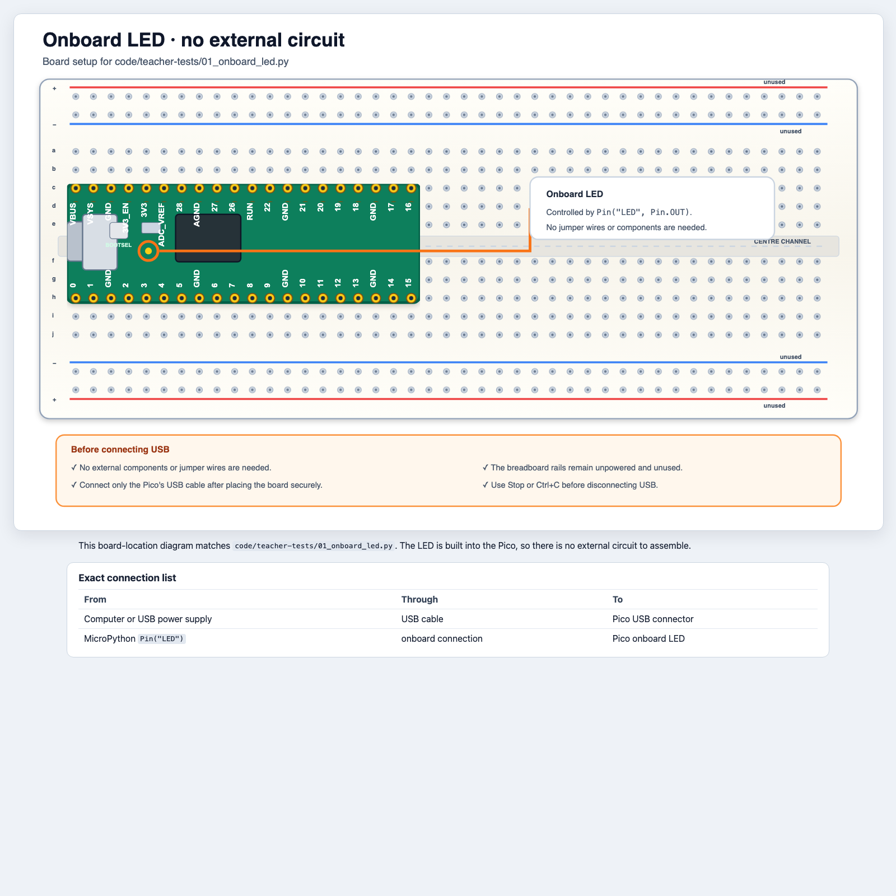
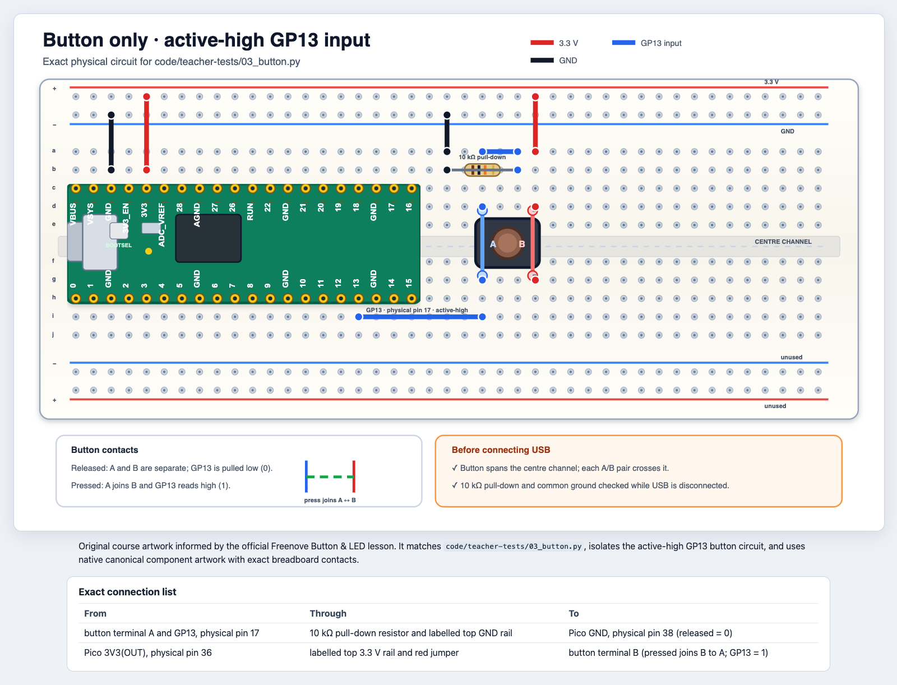
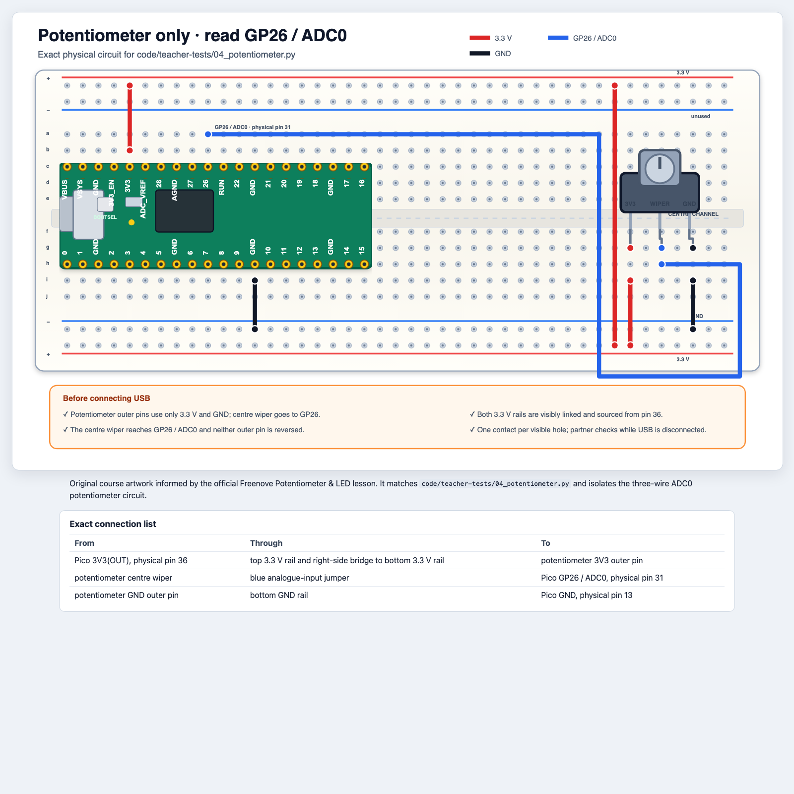

# Wiring and Safety Reference

Use this file as a shared safety and pin reference. It is **not** a second set
of build instructions. For each activity, follow the rendered diagram in that
day's lesson and use the exact connection table below the scalable HTML
diagram.

## Rules for every build

1. Stop the program and disconnect USB before changing any wire or component.
2. Build only from the course diagram for the current activity.
3. Put one wire or component lead in each breadboard hole.
4. Ask a partner to compare every connection with the diagram's table.
5. Use a resistor in series with every ordinary LED.
6. Never connect VBUS (5 V) to a GPIO or directly to GND.
7. Make all grounds common when a circuit uses both 3.3 V and 5 V.
8. Stop immediately if anything becomes hot or smells unusual.
9. Do not hold a buzzer near an ear. Use short, quiet sounds.

The Pico's GPIO pins use **3.3 V logic and are not 5 V tolerant**.

## How to build from a course diagram

Each coloured dot in a diagram marks the centre of one real breadboard hole.
A wire or component lead ends in that hole; two physical contacts never share
one hole.

1. **Gather parts.** Check resistor values and component names before placing
   anything.
2. **Orient the Pico.** Match the USB-left Pico shown in the course diagram.
3. **Place component bodies.** Put the button, LED, and transistor in the
   shown orientation. Keep the HC-SR04 and RGB module off the breadboard,
   connected by male-to-female leads: female sockets on module pins, male
   ends in breadboard holes. Leave the sensor's sound openings clear.
4. **Connect power and ground.** A coloured rail is not powered until a wire
   visibly connects it to Pico `3V3(OUT)`, `VBUS`, or `GND`.
5. **Add signal wires and resistors.** Follow each coloured route from one dot
   to the next. Use the HTML connection table when a route is hard to see.
6. **Check polarity and direction.** Look for LED `A/K`, transistor `E/B/C`,
   sensor pin names, and the RGB module's `IN` header.
7. **Partner-check while unplugged.** Read the connection table aloud while a
   partner points to each physical contact.
8. **Connect USB and run the smallest test.** Stop and unplug again before
   correcting wiring.

## Power and signal quick reference

| Pico connection | Voltage or role | Safe use |
|---|---|---|
| `VBUS` | about 5 V from USB | HC-SR04 and buzzer supply only |
| `3V3(OUT)` | regulated 3.3 V | potentiometer, RGB module, pressed button supply |
| GPIO | 3.3 V signal | input or output named by the program |
| `GND` | 0 V reference | shared return for every part of the circuit |

A red stripe does not determine a rail's voltage. Follow the diagram's
**3.3 V**, **5 V**, and **GND** labels and trace each rail's supply connection.
Never connect 3V3 and VBUS to the same connected rail. Some rails are split
halfway along; check continuity only with power disconnected.

## Pico pins used in this course

| Signal | GPIO name | Physical pin |
|---|---:|---:|
| onboard LED | `LED` | onboard |
| button input | GP13 | 17 |
| buzzer control | GP14 | 19 |
| external LED | GP15 | 20 |
| 8-RGB module data | GP16 | 21 |
| HC-SR04 Echo input | GP18 | 24 |
| HC-SR04 Trigger output | GP19 | 25 |
| potentiometer analogue input | GP26 / ADC0 | 31 |
| 3.3 V | 3V3(OUT) | 36 |
| USB 5 V | VBUS | 40 |
| diagram ground connections | GND | 13, 23, or 38 |

GPIO numbers are the names used in Python. Physical pin numbers identify the
positions around the board. Always use the exact pin named in the current
diagram.

## Onboard LED

The Pico's onboard LED needs no external components or jumper wires. The
[onboard-LED diagram](../../diagrams/onboard-led.html) highlights its location:

[](../../diagrams/onboard-led.html)

## Ordinary LED

Build from the
[scalable ordinary-LED diagram](../../diagrams/ordinary-led.html) in
[Day 1](day-1-make-it-light.md#4-build-an-external-led).

| From | Through | To |
|---|---|---|
| GP15 | 220 Ω resistor | LED long anode leg |
| LED short cathode leg / flat edge | bottom GND rail | Pico GND |

Before power: confirm the resistor is present and the long LED leg faces the
resistor.

## Button

Build from the
[scalable button-and-LED diagram](../../diagrams/button-and-led.html) in
[Day 2](day-2-make-it-decide.md#1-a-button-is-a-boolean-question).
For the isolated teacher input test, use the
[button-only diagram](../../diagrams/button-only.html):

[](../../diagrams/button-only.html)

A four-leg tactile button has only two electrical terminals. The two legs in
terminal A are always connected; the two legs in terminal B are always
connected. Pressing joins A to B. The button must straddle the breadboard
centre channel in the orientation shown.

| Part | Connection |
|---|---|
| button signal | GP13 |
| pull-down | 10 kΩ from GP13 to GND |
| button other terminal | 3.3 V |
| external LED | GP15 through 220 Ω to LED, then GND |

Before power: use continuity mode if available. A pair in one terminal should
be connected while released; A and B should connect only while pressed.
This is **active-high**: released reads `0`, pressed reads `1`.

## Incremental button, potentiometer, and PWM LED

Build from the
[scalable potentiometer-and-LED diagram](../../diagrams/potentiometer-and-led.html)
in [Day 2](day-2-make-it-decide.md#2-from-analogue-world-to-numbers).
Keep the button circuit from the previous activity connected and add only the
potentiometer. The potentiometer program ignores GP13; the later reaction game
ignores GP26.

[](../../diagrams/potentiometer-and-led.html)

For the isolated teacher ADC test, use the
[potentiometer-only diagram](../../diagrams/potentiometer-only.html):

[](../../diagrams/potentiometer-only.html)

| Part | Connection |
|---|---|
| potentiometer `3V3` outer pin | 3.3 V |
| potentiometer centre `WIPER` | GP26 / ADC0 |
| potentiometer `GND` outer pin | GND |
| button signal | GP13 with 10 kΩ pull-down to GND |
| button other terminal | 3.3 V |
| LED | GP15 through 220 Ω to LED, then GND |

Use only 3.3 V across the potentiometer. Turning the shaft moves the centre
wiper between 0 V and 3.3 V.

## Freenove 8-RGB LED module

Build from the
[scalable 8-RGB module diagram](../../diagrams/rgb8-module.html) in
[Day 3](day-3-make-it-reusable.md#1-meet-the-rgb-module).

Connect the header marked **IN**, not OUT:

| Module pin | Pico |
|---|---|
| `IN S` | GP16 |
| `IN V` | 3.3 V |
| `IN G` | GND |

The examples deliberately use low RGB values to reduce glare and current.
Use three male-to-female cables to keep the module off the breadboard.
For Pixel Pet, use the complete
[RGB-and-potentiometer diagram](../../diagrams/neopixel-and-potentiometer.html):

[](../../diagrams/neopixel-and-potentiometer.html)

## Passive buzzer with transistor driver

Build from the
[scalable passive-buzzer diagram](../../diagrams/passive-buzzer.html) in
[Day 4](day-4-make-it-sense.md#3-test-the-passive-buzzer).

| From | Through | To |
|---|---|---|
| GP14 | 1 kΩ resistor | S8050 base `B` |
| VBUS / 5 V | passive buzzer | S8050 collector `C` |
| S8050 emitter `E` | GND rail | Pico GND |

Do not drive the buzzer directly from a GPIO. Check the flat face and `E/B/C`
order shown in the diagram before inserting the transistor.

## HC-SR04 distance sensor: safer Echo connection

Build from the
[scalable safe HC-SR04 diagram](../../diagrams/distance-sensor.html) in
[Day 4](day-4-make-it-sense.md#safety-gate).

The HC-SR04 uses 5 V, so Echo can rise close to 5 V. This course intentionally
replaces the official direct Echo wire with a voltage divider:

| HC-SR04 pin | Connection |
|---|---|
| VCC | VBUS / 5 V, physical pin 40 |
| Trig | GP19, physical pin 25 |
| Echo | through **1 kΩ** to the divider junction |
| divider junction | GP18 and **2 kΩ** to GND |
| GND | Pico GND |

The divider produces approximately `5 V × 2/(1+2) = 3.33 V`. An instructor
should inspect every unpowered sensor circuit before USB is connected.

Keep the sensor off the breadboard using four male-to-female leads. Read
the actual header labels: reversing Trig and Echo will prevent measurement.

**No 2 kΩ resistor in your kit?** Replace only the lower 2 kΩ leg with two
1 kΩ resistors in series:

```text
Echo -- 1 kΩ -- junction -- GP18
                  |
                 1 kΩ
                  |
                 1 kΩ
                  |
                 GND
```

Use separate holes in connected terminal strips to join the resistors;
their middle junction has no other connection. This needs three 1 kΩ
resistors for the sensor divider and another for the buzzer driver. Ask
an instructor to check the alternative while unplugged. Never use two
1 kΩ resistors in parallel here, and never omit the divider.

## Combined builds

The [Day 4 proximity-alarm diagram](../../diagrams/proximity-alarm.html) combines
the protected sensor and transistor-driven buzzer. The
[Day 5 parking-assistant lesson](day-5-parking-assistant.md) adds the 8-RGB
module on GP16 and keeps its 3.3 V supply separate from the 5 V sensor and
buzzer supply.

| Component | Signal | Power |
|---|---|---|
| HC-SR04 | Trig GP19; divided Echo to GP18 | 5 V and GND |
| passive buzzer driver | GP14 through 1 kΩ to base | 5 V and GND |
| 8-RGB module `IN` | GP16 | 3.3 V and GND |

There are no GPIO conflicts in this plan.

## Source note

The course diagrams are original vector artwork informed by the official
Freenove lessons. Source links and attribution are collected in
[Sources, Images, and Attribution](../../SOURCES_AND_IMAGES.md). The official
HC-SR04 image is a factual reference only; students must use the safer course
diagram with the Echo divider.
