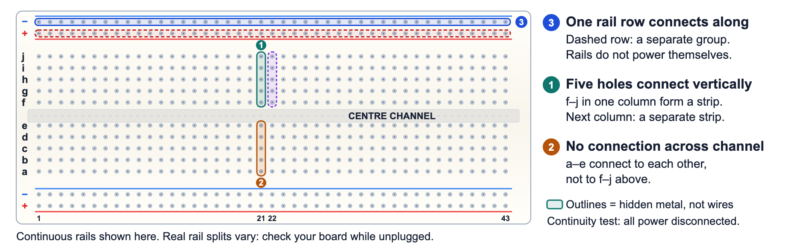
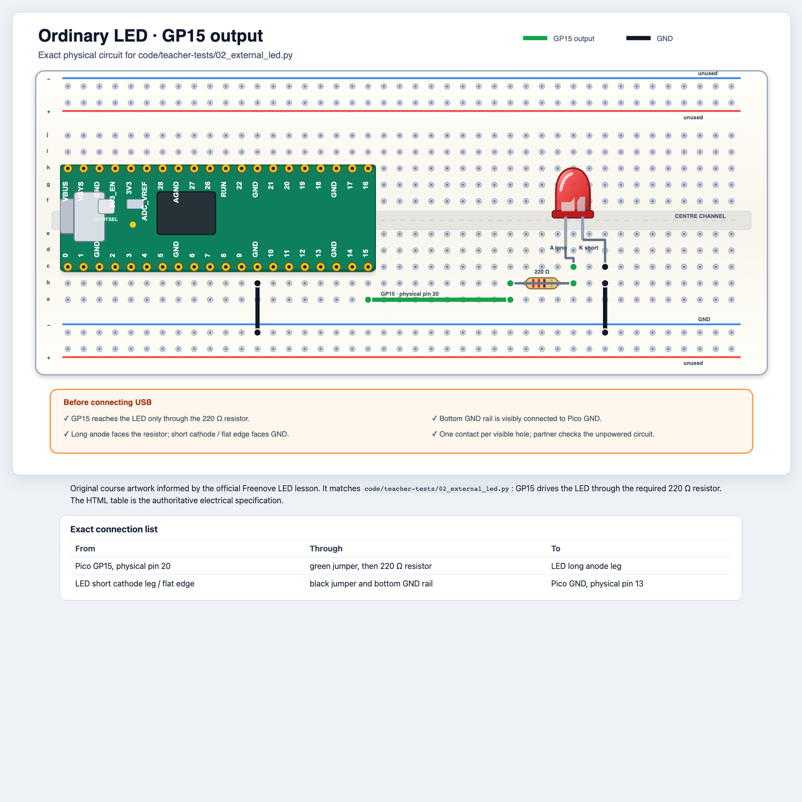

# Day 1: Make It Light

## Mission

By the end of today, your code will send a secret message using light.

**Python:** interpreter, script, `print`, strings, integers, floats, variables,
assignment, comments, imports, errors, `try`/`finally`<br>
**Hardware:** onboard LED, external LED, GPIO output<br>
## 1. Meet the interpreter

Start without a Pico. Open Thonny and select **Local Python 3** (Thonny's
built-in Python) at the bottom right, not MicroPython. These first examples
run on your computer. If the file browser is hidden, choose **View → Files**.

In Thonny's Shell, type one line at a time:

```python
print("Hello, Pico!")
2 + 3
```

Discuss:

- A string is text in quotes.
- An integer is a whole number.
- A float contains a decimal point.
- An expression produces a value.
- An interpreter runs code.

After discussing these types, use `type(...)` to ask Python which type a value
has:

```python
type("hello")
type(42)
type(0.5)
```

Make three intentional errors. Read the final line of each error message:

```python
print("missing quote)
pritn("misspelled name")
10 / 0
```

Errors are information, not failure.

### Run a script on the computer

1. Click <a href="../../code/day-1/00_first_script.py" download="00_first_script.py"><code>00_first_script.py</code></a>
   to download it to **Downloads**. If the browser asks where to save it,
   choose **Downloads** and keep the `.py` filename.
2. In Thonny's **Files pane on the left**, navigate to the **Downloads**
   folder on your computer. If the pane is hidden, choose **View → Files**.
   Double-click **`00_first_script.py`** to open it in the editor.
3. Keep **Local Python 3** selected. Predict the output, then click the
   **green play button (Run)**. The output appears in the Shell.

The editor now shows a **script**: instructions saved in a `.py` file.
Python runs them from top to bottom. Click the green play button again to
repeat the whole sequence:

```python
print("Three...")
print("Two...")
print("One...")
print("Hello, physical world!")
```

Now replace the contents of that same file with the example below to add
pauses. Predict the message order and pauses, choose **File → Save**, then
click the **green play button (Run)**:

```python
from time import sleep

print("Three...")
sleep(1)
print("Two...")
sleep(1)
print("One...")
```

`import` lets us use ready-made tools. Python groups these tools in **modules**.
`from time import sleep` makes the pause function `sleep` available from the
`time` module, Python's toolbox for time-related tasks. The import does not
pause the program; `sleep(1)` pauses for one second. No Pico or wiring is needed.

## 2. Your first physical program

Wait until your teacher hands out the Picos and introduces the board. The Pico
is a microcontroller board that runs Python using **MicroPython** and can
read sensors and control electronic components.

Connect the Pico by USB, then switch Thonny's interpreter from **Local Python 3**
to **MicroPython (Raspberry Pi Pico)**. Leave the port on **automatic detection**.
Check for `>>>` in the Shell; code now runs on the Pico, not on your computer.
The onboard LED needs no external wiring.

1. Click <a href="../../code/day-1/01_hello_pico.py" download="01_hello_pico.py"><code>01_hello_pico.py</code></a>
   to download it to **Downloads**. If the browser asks where to save it,
   choose **Downloads**.
2. In Thonny's **Files pane on the left**, open **Downloads on your computer**
   and double-click **`01_hello_pico.py`**. Keep the file on the computer, not
   on the Pico. Check its name on the editor tab: this is a different file
   from `00_first_script.py`.
3. Before running it, check **MicroPython (Raspberry Pi Pico)** is selected.
   The supplied `try` block runs the sequence; `finally` switches the LED off
   at the end, on an error, or when you press Stop. Keep both blocks.
4. Predict the order of the printed messages and LED changes, then click the
   **green play button (Run)**. Watch the Shell and the onboard LED together.

```python
from machine import Pin
from time import sleep

led = Pin("LED", Pin.OUT)

try:
    print("Three...")
    led.on()
    sleep(1)

    print("Two...")
    led.off()
    sleep(1)

    print("One...")
    led.on()
    print("Hello, physical world!")
    sleep(1)
finally:
    led.off()
```

Run it again to compare what you predicted with what happened. Then change
the words and delay, save, and click the green play button again.

`Pin("LED", Pin.OUT)` creates an output object. Calling `led.on()` changes a
voltage, which changes the real world.

## 3. Variables are labelled storage

Run [`code/day-1/02_variable_blink.py`](../../code/day-1/02_variable_blink.py).

Change only these values:

```python
message = "Team Comet"
on_time = 0.15
off_time = 0.35
```

Which change affects text, and which changes affect timing? Why are the timing
values floats rather than strings?

The file repeats three similar blocks of code on purpose. Do not worry about
shortening them yet. On Day 3, you will learn loops and functions that remove
this kind of repetition.

## 4. Build an external LED

### How the breadboard connects

Look at the [marked template breadboard and connectivity table](../../diagrams/breadboard-connectivity.html):



**1:** the five holes f–j in one column are joined; the next column is separate.
**2:** a–e form another group, not joined across the centre channel.
**3:** holes along one rail row are joined, separately from other rail rows.
These markings show hidden metal strips, not wires you need to add.
The letters run from a at the bottom to j at the top. Each rail bank has blue
(−) above red (+), matching the workshop breadboard.

With USB disconnected, inspect the breadboard before placing components:

- Each five-hole strip in a terminal field is internally connected.
- The centre channel separates the two terminal fields; matching holes on
  opposite sides are **not** connected.
- Long outer power rails are separate from the terminal strips and from each
  other. Some rails have a break halfway along: check continuity while unplugged.
- A red stripe is only a marking, not a voltage source. A rail becomes 3.3 V
  or 5 V only when connected to the matching Pico supply. Never join those supplies.
- Put one lead in each hole; join components through separate holes in the
  same connected strip.

Disconnect USB first.

Open the
[scalable, accessible ordinary-LED diagram](../../diagrams/ordinary-led.html) and
build from its exact connection table.



Reconnect only after both partners check:

- GP15 goes through a 220 Ω resistor to the LED;
- the LED's long and short legs are correctly oriented;
- GND and GP15 are not directly connected.

Make a copy of `code/day-1/02_variable_blink.py`. In the copy, replace
`Pin("LED", Pin.OUT)` with `Pin(15, Pin.OUT)`, then run the smallest external
LED test before changing the pattern.

### Safe stopping with `try`/`finally`

Before the first program that uses it, learn this cleanup pattern:

```python
try:
    led.on()
    sleep(1)
finally:
    led.off()
```

The indented `try` block runs the activity. `finally` runs when execution
leaves it, whether the activity finishes, an error occurs, or `Ctrl+C`
interrupts it. It leaves the LED off. It does not hide errors; Thonny may
still show `KeyboardInterrupt`. Later programs use the same pattern for PWM
and RGB pixels. Disconnecting power is not a way to run cleanup.

## 5. Debugging relay

Your teacher will give each pair one fault:

- missing parenthesis;
- wrong capital letter;
- wrong pin number;
- LED reversed;
- one wire one row away;
- code still running from a previous test.

Describe the symptom, make one test, and record the evidence. Do not randomly
change code and wiring together.

## Daily build: Secret Signal Machine

Invent a signal with:

- a printed team name;
- at least two named timing variables;
- short and long flashes;
- a clear pause between groups of flashes;
- comments explaining the message;
- a clean final `off` state.

Start from
[`code/day-1/03_secret_signal_1_starter.py`](../../code/day-1/03_secret_signal_1_starter.py).
Do not open the solution until your own message works.

Possible themes: space beacon, robot greeting, lighthouse, goal celebration, or
Morse-code initials.

### Demo checklist

- Can another team tell where one group of flashes ends and the next begins?
- Can you change speed by editing only variables?
- Can you explain the difference between the program and the output?

## Exit ticket

Complete this sentence: “When Python runs `led.on()`, the output is ___, and
when Python runs `print()`, the output is ___.”
